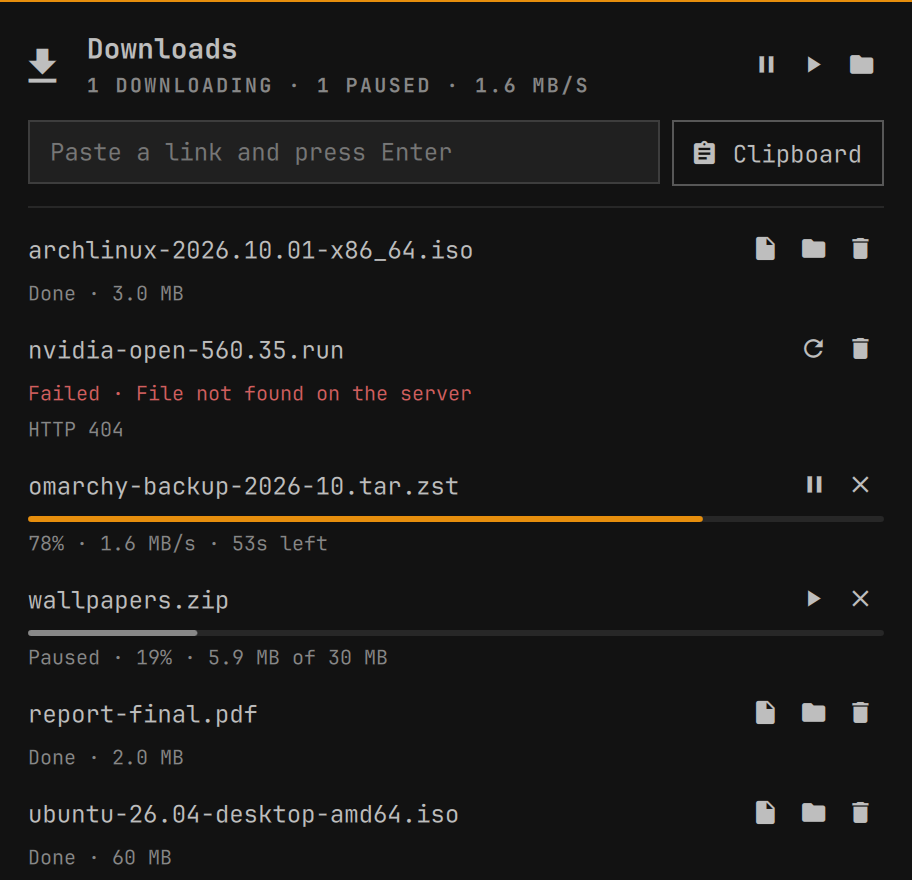

# Downloads for Omarchy

A download manager that lives in the Omarchy bar. Paste a link, or right-click the icon to grab the one on your clipboard, then watch, pause, resume or retry it from the panel.



Downloads don't run inside the bar. Omarchy's shell reloads its plugins whenever a plugin file changes, and restarts on updates. Anything the bar started would die with it. Instead, a small engine (`dmd`, driving [aria2](https://aria2.github.io/)) runs as a systemd user service, and the bar only shows its state and sends it commands. That's what makes downloads survive:

- shell restarts, plugin reloads and Omarchy updates;
- the engine or aria2 crashing (systemd restarts it; the download resumes where it stopped);
- network drops and suspend: retries wait for NetworkManager to report a connection instead of giving up;
- reboots: unfinished downloads pick up again at login.

## Install

```bash
omarchy plugin add https://github.com/puneethkethanapalli/dm --enable
```

Then click the download icon in the bar and press **Set up**. That installs `aria2`, starts the `dm` user service, and puts the `dm` command in `~/.local/bin`. You can also run `./setup` from the plugin folder yourself. Re-run it after updating the plugin, or press **Restart engine** when the panel says the engine is out of date.

## Use

- **Browser:** downloads you start in Brave or Chromium go to dm automatically (see below).
- **Panel:** paste a link and press Enter, or press **Clipboard**. The speed-limit buttons at the bottom cap the overall speed (Off, 1, 5 or 20 MB/s).
- **Video pages:** paste a YouTube (or any other [yt-dlp-supported](https://github.com/yt-dlp/yt-dlp/blob/master/supported-sites.md)) page link and dm downloads the video itself with yt-dlp, into your Videos folder. It shows in the panel with progress, pause and retry like any other download.
- **Bar icon:** left-click opens the panel; right-click downloads the link on the clipboard. The icon shows what's happening without opening anything: it lights up in the bar's highlight colour while downloading, the arrow drops in when a download is added (from the browser too) and dips now and then while data is coming in, with the overall progress filling the line underneath; a tick pops up when a download finishes, and a red warning sign shakes when one fails. Each of these also shows a short notice under the icon with the file name and progress, which stays while you hover it and opens the panel when clicked. It never takes focus or closes a panel you have open.
- **Command line:**

  ```bash
  dm add https://example.com/file.iso                    # into your Downloads folder
  dm add URL --dir ~/ISOs --name arch.iso --sha256 <hex> # fails if the checksum differs
  dm add URL --header 'Cookie: session=…'                # for links that need a login
  dm add --clipboard
  dm add --media URL                                     # a video page (recognised on its own for known sites)
  dm add --file URL                                      # the URL itself, even if it's a video page
  dm limit 2M                                            # cap the overall speed; `dm limit off` removes it
  dm ls                     # IDs can be shortened to any unique prefix
  dm pause ID|all · dm resume ID|all · dm retry ID · dm cancel ID
  dm remove ID|finished     # drop from the list; the files stay
  dm open ID · dm reveal ID
  dm status
  ```

- **Key bindings** (in `~/.config/hypr/bindings.lua`):

  ```lua
  o.bind("SUPER + ALT + D", "Download clipboard link", "omarchy-shell downloads clipboard")
  o.bind("SUPER + SHIFT + D", "Downloads", "omarchy-shell shell toggle io.github.puneethkethanapalli.dm")
  ```

## Browser downloads

Setup also installs a small extension for Brave Origin, Brave and Chromium. Restart the browser once afterwards. When you start a download in the browser:

1. The extension pauses the browser's copy and hands the link to dm, together with the site's cookies, the page you were on and the browser's identity, so downloads that need you logged in still work.
2. dm checks the website will really give it the file.
3. Only when dm is actually receiving data does the browser drop its copy; the download then shows up in the bar.

All of this happens before the browser would ask where to save the file, so with "Ask where to save each file before downloading" turned on (Brave's default) you still get no Save dialog for downloads dm takes. If dm isn't running, the website refuses it, or it's a link only the browser can use (one-time links, `blob:` downloads), the browser just carries on as if nothing happened, Save dialog included, and the extension's icon briefly shows ↩. Downloads from private windows are never sent to dm.

The extension's toolbar button turns the automatic hand-over on or off, downloads the current page's video, and opens the Downloads panel. Right-click any link, image or video and choose **Download with dm** to send just that one, or **Download video with dm** on a video page.

Setup adds the extension to the `--load-extension` line of `~/.config/brave-origin-flags.conf` (and `chromium-flags.conf`), the same way Omarchy loads its own extensions, and keeps a `.dm-backup` of the file. If an Omarchy update rewrites that line, run `./setup` again. `bin/dm-browser status` shows what's installed where.

## Settings

Optional, in `~/.config/dm/config.json`. The engine reads this file when it starts, so restart the engine after editing it (`systemctl --user restart dm`).

| Key | Default | |
|---|---|---|
| `download_dir` | your XDG Downloads folder | where finished files go |
| `video_dir` | your XDG Videos folder | where videos from video pages go |
| `max_concurrent` | `3` | downloads running at once |
| `connections_per_server` | `8` | parallel connections per download |
| `max_retries` | `5` | retries after network or server errors (5 s, 15 s, 45 s, 2 min, 5 min apart) |
| `speed_limit` | `"0"` | overall cap, e.g. `"2M"`; `"0"` is unlimited. Also set from the panel or with `dm limit`, which apply at once |
| `inhibit_sleep` | `false` | hold off idle suspend while downloading |
| `notify` | `true` | notify when a download finishes or fails |
| `keep_finished` | `50` | finished downloads kept in the list |

To hide the bar icon while nothing is downloading, run `omarchy bar set io.github.puneethkethanapalli.dm hideWhenIdle true --json`.

## How it stays reliable

- **One source of truth.** The job list lives in `~/.local/state/dm/jobs.json` and is written atomically. aria2 only holds the transfers currently queued or running; everything else gets resubmitted from the list after a restart.
- **No half-written files.** Each download goes into its own `.dm-partial/<id>/` folder inside the destination. When it completes, it's moved into place without overwriting anything (`name (1).ext` if the name is taken), and the move is safe to repeat after a crash.
- **No silently mixed files.** aria2 resumes interrupted transfers without checking whether the file changed on the server in the meantime. dm records the file's ETag, Last-Modified and size, and checks them before every resume and again at completion. If they changed, it starts over.
- **Links that can't resume are marked.** Some websites can only send a file from the start. dm finds this out as soon as a download begins and labels it "can't resume" in the panel and in `dm ls`. Pausing one warns that it will start over, and every restart begins cleanly from the first byte.
- **Failures you can act on.** Network and server errors (timeouts, 5xx, DNS) retry with backoff, and wait without using up retries while you're offline. A 404, 403, full disk or checksum mismatch fails at once with a plain reason.
- **Locked down.** aria2's control interface listens only on localhost, needs a random secret kept in a 0600 file, and has no on-completion hooks. The bar and CLI talk to the engine over a 0600 Unix socket in `$XDG_RUNTIME_DIR/dm/`. Only http(s), ftp and sftp links are accepted.

## Limits

- A download that starts in the first second or two after the browser opens can arrive before the extension is ready; that one stays in the browser.
- Cookies (from the browser, or passed with `--header`) are also sent if the server redirects the download to another site. The browser has usually followed the redirects already, so this rarely matters; still, only pass headers by hand for links you trust.

## Tests

`tests/run.py` is a fault-injection suite. It starts a private engine against a misbehaving local server and checks each case. It covers:

- dropped connections, servers that can't resume, and files that change mid-download;
- redirects, UTF-8 file names, 404/403/503 responses and checksum mismatches;
- name clashes, pause and resume, and cancel;
- what `dm ls` and `dm status` print for downloads in every state;
- video pages through yt-dlp (download, pause/resume, failure, site recognition) and the speed limit;
- `kill -9` of the engine and of aria2, network outages, a full disk, and the security settings.

```bash
python -I tests/run.py
```

It needs `aria2c`, and `unshare` for the disk-full case. All files go to a temp directory and `$XDG_RUNTIME_DIR/dm-tests`.

`tests/browser.py` runs the extension in a real browser with a throwaway profile. It checks that a members-only download is handed over with its login cookie (also with "Ask where to save" on, without the browser's Save dialog opening), and that a one-time link dm can't fetch is finished by the browser instead (and, with asking on, still gets its Save dialog; that check needs `--xvfb`):

```bash
python -I tests/browser.py                              # Chromium, headless
python -I tests/browser.py --browser brave-origin --xvfb  # Brave, on a virtual screen
```

Set `DM_HOST_LOG=/some/file` to have the browser connector log the messages it handles.

## Uninstall

```bash
./uninstall.sh            # stops and removes the engine; add --purge to drop the job list and settings
omarchy plugin remove io.github.puneethkethanapalli.dm
```

Downloaded files are never deleted.
